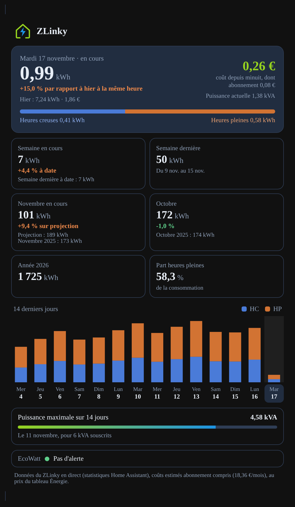

<p>
  ☕ <strong>Si cette carte vous est utile, vous pouvez soutenir le projet :</strong>
</p>

<div style="white-space: nowrap; line-height: 0;">
  <a
    href="https://www.buymeacoffee.com/Marlboro62"
    target="_blank"
    rel="noopener noreferrer"
    style="display: inline-block; text-decoration: none; vertical-align: middle;"
  ></a>&nbsp;&nbsp;<a
    href="https://ko-fi.com/M4M2QL45X"
    target="_blank"
    rel="noopener noreferrer"
    style="display: inline-block; text-decoration: none; vertical-align: middle;"
  ></a>
</div>

# Carte ZLinky

Carte Lovelace pour la consommation électrique lue **en direct** par un **LiXee ZLinky** (téléinfo du compteur Linky en Zigbee, avec ZHA ou Zigbee2MQTT).

Même présentation que la [Carte Enedis Linky New](https://github.com/Marlboro62/content-card-linky-new), mais sans MyElectricalData ni Enedis : tout vient des statistiques de Home Assistant.



## Ce que la carte affiche

- **Aujourd'hui, en direct** : consommation depuis minuit, répartition heures creuses / heures pleines, coût, puissance actuelle, et écart avec hier à la même heure.
- **Semaine, mois et année** jusqu'à hier, avec la projection du mois en cours.
- **Comparaison avec l'an dernier** seulement si les statistiques couvrent presque toute la période (au moins 90 % des jours) : pas de « 0 kWh » ni de pourcentage trompeur sur une installation récente.
- **Graphique** des 7, 14 ou 31 derniers jours ; un clic sur un jour affiche son détail.
- **Puissance maximale** par jour (avec la puissance apparente du ZLinky).
- **EcoWatt** et **Tempo** (capteurs RTE), facultatifs.

## Installation

1. **Paramètres › Marketplace** (ou HACS avant la 2026.11) › menu ⋮ › **Dépôts personnalisés** : ajoutez `https://github.com/Marlboro62/ZLinky-Card`, catégorie **Tableau de bord** (Lovelace).
2. Installez **Carte ZLinky**, puis rechargez la page (**Ctrl+F5**).
3. Ajoutez la carte **Carte ZLinky** à un tableau de bord : l'éditeur propose les index du ZLinky qu'il trouve.

## Configuration

```yaml
type: custom:zlinky-card
hc_entity: sensor.zlinky_index_hc        # index heures creuses
hp_entity: sensor.zlinky_index_hp        # index heures pleines
power_entity: sensor.zlinky_puissance    # puissance apparente (facultatif)
subscribed_power: 6                      # kVA souscrits (facultatif)
subscription_price: 18.36                # abonnement mensuel TTC (facultatif)
```

| Option | Rôle | Par défaut |
| --- | --- | --- |
| `hc_entity`, `hp_entity` | Index heures creuses et heures pleines (Wh ou kWh) | — |
| `base_entity` | Index Base, à la place des deux précédents pour un contrat Base | — |
| `power_entity` | Puissance apparente (VA) : pic par jour et puissance actuelle | — |
| `days` | Jours affichés dans le graphique : 7, 14 ou 31 | 14 |
| `subscribed_power` | Puissance souscrite en kVA (jauge et dépassements) | — |
| `show_cost` | Afficher les coûts | `true` |
| `energy_prices` | Prendre les prix réglés dans le **tableau Énergie** | `true` |
| `hc_price`, `hp_price`, `base_price` | Prix du kWh TTC saisis dans la carte : ils **passent avant** ceux du tableau Énergie | — |
| `subscription_price` | Abonnement mensuel TTC, ajouté au coût au prorata des jours | — |
| `show_week`, `tiles_horizontal` | Cases de la semaine en cours et de la semaine dernière ; disposition en 3 colonnes | `false` |
| `show_power`, `show_ecowatt`, `show_tempo` | Puissance maximale, EcoWatt, Tempo (capteurs RTE) | `true`, `true`, `false` |
| `theme` | `v2` (bleu nuit), `auto` (clair si Home Assistant est en clair), `ha` (thème de Home Assistant) | `v2` |
| `font_size` | Taille du texte en % | 100 |

Les couleurs des heures creuses et pleines se règlent avec les roues de couleur de l'éditeur.

## Bon à savoir

- Les index doivent avoir des **statistiques à long terme** (classe d'état `total_increasing`, c'est le cas des index du ZLinky) : la carte lit les totaux par jour et par heure enregistrés par Home Assistant.
- L'historique affiché commence à la mise en service du ZLinky dans Home Assistant.
- Les statistiques sont relues toutes les 5 minutes ; le total du jour suit l'index en direct.

## Support

Un souci ou une idée ? Ouvrez une [issue sur GitHub](https://github.com/Marlboro62/ZLinky-Card/issues). Pas de support ailleurs.

## Licence

[MIT](LICENSE) © 2026 Marlboro62
