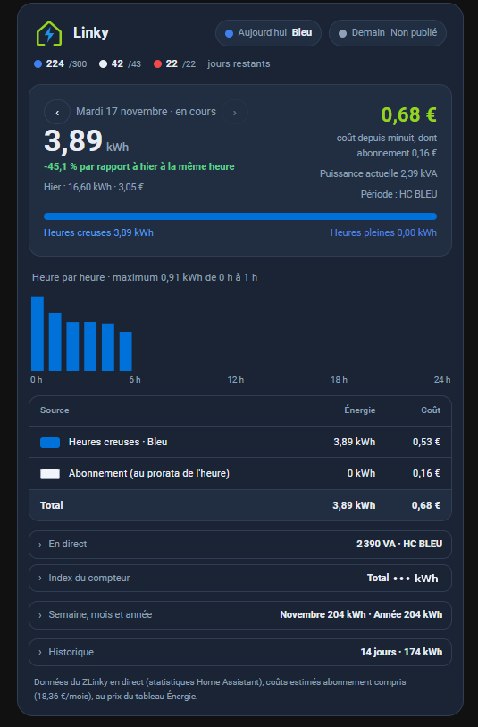
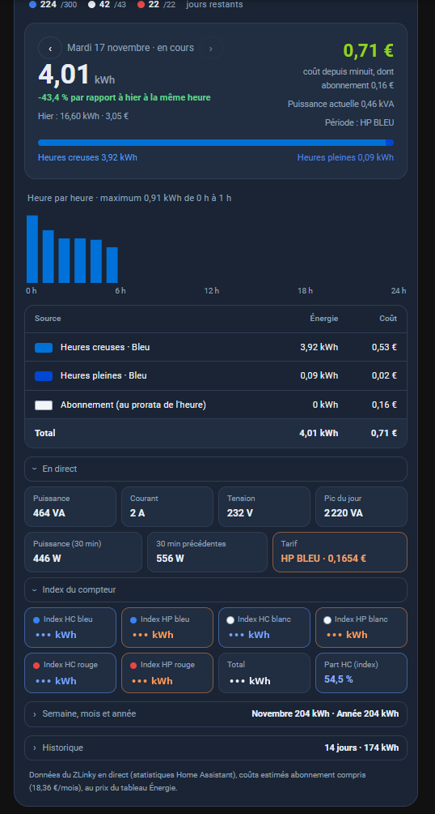
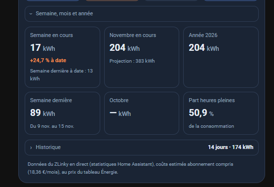
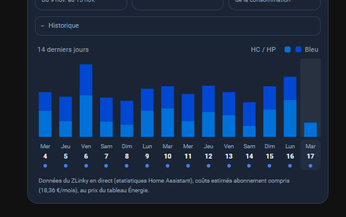

<p>
  ☕ <strong>Si cette carte vous est utile, vous pouvez soutenir le projet :</strong>
</p>

<div style="white-space: nowrap; line-height: 0;">
  <a
    href="https://www.buymeacoffee.com/Marlboro62"
    target="_blank"
    rel="noopener noreferrer"
    style="display: inline-block; text-decoration: none; vertical-align: middle;"
  ></a>&nbsp;&nbsp;<a
    href="https://ko-fi.com/M4M2QL45X"
    target="_blank"
    rel="noopener noreferrer"
    style="display: inline-block; text-decoration: none; vertical-align: middle;"
  ></a>
</div>

# Carte ZLinky

Carte Lovelace pour la consommation électrique lue **en direct** par un **LiXee ZLinky** (téléinfo du compteur Linky en Zigbee, avec ZHA ou Zigbee2MQTT).

Même présentation que la [Carte Enedis Linky New](https://github.com/Marlboro62/content-card-linky-new), mais sans MyElectricalData ni Enedis : tout vient des statistiques de Home Assistant.

**🎮 [Essayer la démo en ligne](https://marlboro62.github.io/ZLinky-Card/docs/demo.html)** : la vraie carte avec des données inventées, sans Home Assistant ni ZLinky (Tempo, heures creuses / pleines, Base, message du compteur, thème clair ou sombre).

<p>
  
  
</p>

<p>
  
  
</p>

<sub>Captures d'une installation réelle en Tempo ; les valeurs des index du compteur sont masquées.</sub>

## Ce que la carte affiche

- **Aujourd'hui, en direct** : consommation depuis minuit, répartition heures creuses / heures pleines, coût, puissance actuelle, et écart avec hier à la même heure.
- **Compteur en direct** : puissance apparente, puissance active des 30 dernières minutes et des 30 précédentes (chacune avec son interrupteur), courant, tension, pic du jour, tarif en cours avec son prix, chaque index (un par couleur et HC/HP en Tempo), total et part des heures creuses, qualité du lien Zigbee.
- **Semaine, mois et année** jusqu'à hier, avec la projection du mois en cours.
- **Comparaison avec l'an dernier** seulement si les statistiques couvrent presque toute la période (au moins 90 % des jours) : pas de « 0 kWh » ni de pourcentage trompeur sur une installation récente.
- **Jours précédents** : les flèches ‹ › de l'encadré du haut (ou un clic sur une barre du graphique) affichent un autre jour, avec sa consommation **heure par heure** ; « Aujourd'hui » revient au jour en cours.
- **Détail du jour**, comme le tableau Énergie : énergie et coût de chaque index (en Tempo, ceux qui ont tourné ce jour-là), abonnement, total.
- **Graphique** des 7, 14 ou 31 derniers jours.
- **Puissance maximale** par jour (avec la puissance apparente du ZLinky).
- **EcoWatt** et **Tempo** (capteurs RTE), facultatifs.
- **Sections rabattables** : En direct, Index du compteur, Semaine, mois et année, et Historique se replient d'un clic, avec un résumé sur la ligne du titre ; l'éditeur choisit celles ouvertes au chargement.
- **Messages du compteur** : quand le fournisseur ou le distributeur envoie un message au Linky (MSG1, MSG2), il s'affiche en fenêtre sur la carte. Le bouton × la ferme ; elle ne revient que si le message change. « PAS DE MESSAGE » est ignoré. L'interrupteur **Tester la fenêtre de message** de l'éditeur affiche un exemple.

## Installation

[](https://my.home-assistant.io/redirect/hacs_repository/?owner=Marlboro62&repository=ZLinky-Card&category=plugin)

1. Ouvrez **Paramètres › Marketplace** (ou HACS avant la 2026.11), ou utilisez le bouton ci-dessus.
2. Cherchez **Carte ZLinky**, installez-la, puis rechargez la page (**Ctrl+F5**).
3. Ajoutez la carte **Carte ZLinky** à un tableau de bord : l'éditeur propose les index du ZLinky qu'il trouve.

Si la carte n'apparaît pas dans la recherche, ajoutez-la comme dépôt personnalisé : menu ⋮ › **Dépôts personnalisés**, adresse `https://github.com/Marlboro62/ZLinky-Card`, catégorie **Tableau de bord** (Lovelace), puis reprenez l'étape 2.

## Configuration

Le plus simple est l'**éditeur visuel** : à l'ajout de la carte, il repère les index du ZLinky (ZHA ou Zigbee2MQTT). Si un index est introuvable, la carte affiche ceux qu'elle a trouvés dans Home Assistant.

Les noms ci-dessous sont des **exemples** : remplacez-les par ceux de vos capteurs (**Outils de développement › États**, cherchez `linky` ou `lixee`).

Contrat **heures creuses / heures pleines** :

```yaml
type: custom:zlinky-card
hc_entity: sensor.mon_zlinky_tier_1_summation_delivered   # index heures creuses
hp_entity: sensor.mon_zlinky_tier_2_summation_delivered   # index heures pleines
power_entity: sensor.mon_zlinky_apparent_power            # puissance apparente (facultatif)
subscribed_power: 6                                       # kVA souscrits (facultatif)
subscription_price: 18.36                                 # abonnement mensuel TTC (facultatif)
```

Contrat **Tempo** : les 6 index du ZLinky (avec ZHA, `tier_1` à `tier_6` dans cet ordre ; avec Zigbee2MQTT, `BBRHCJB` à `BBRHPJR`) :

```yaml
type: custom:zlinky-card
hc_blue_entity: sensor.mon_zlinky_tier_1_summation_delivered    # HC jour bleu
hp_blue_entity: sensor.mon_zlinky_tier_2_summation_delivered    # HP jour bleu
hc_white_entity: sensor.mon_zlinky_tier_3_summation_delivered   # HC jour blanc
hp_white_entity: sensor.mon_zlinky_tier_4_summation_delivered   # HP jour blanc
hc_red_entity: sensor.mon_zlinky_tier_5_summation_delivered     # HC jour rouge
hp_red_entity: sensor.mon_zlinky_tier_6_summation_delivered     # HP jour rouge
tariff_entity: sensor.mon_zlinky_ptec                           # période en cours (facultatif)
tempo_tomorrow: sensor.mon_zlinky_demain                        # couleur de demain (facultatif)
```

Contrat **Base** : `base_entity: sensor.mon_zlinky_summation_delivered`.

Avec Zigbee2MQTT en **mode standard**, les index portent le nom écrit par le compteur (`HC BLEU`, `HP ROUGE`…), la période en cours est **LTARF** (`HP BLEU`) et la puissance apparente **SINSTS** : l'éditeur les repère aussi. Selon la version, les index s'appellent aussi **EASF01** à **EASF06** : en Tempo, dans l'ordre HC bleu, HP bleu, HC blanc, HP blanc, HC rouge, HP rouge ; en heures creuses / pleines, EASF01 (HC) et EASF02 (HP) ; **EAST** est l'index total (Base).

En Tempo, chaque jour prend la couleur de ses index : pastilles du graphique, détail du jour, couleur des barres si vous la réglez. La pastille « Aujourd'hui » suit la période en cours du ZLinky (`HPJB`, `HCJR`…) quand aucun capteur RTE n'est choisi ; « Demain » accepte aussi la couleur écrite par le ZLinky (`BLEU`, `BLAN`, `ROUG`).

| Option | Rôle | Par défaut |
| --- | --- | --- |
| `hc_entity`, `hp_entity` | Index heures creuses et heures pleines (Wh ou kWh) | — |
| `base_entity` | Index Base, à la place des deux précédents pour un contrat Base | — |
| `hc_blue_entity` … `hp_red_entity` | Les 6 index Tempo (HC et HP des jours bleus, blancs et rouges) | — |
| `tariff_entity` | Période tarifaire en cours (LTARF ou PTEC) : affichée avec son prix, et couleur Tempo du jour | — |
| `current_entity`, `voltage_entity` | Courant (IRMS1) et tension (URMS1) | — |
| `max_power_entity` | Puissance maximale du jour (SMAXSN) | — |
| `lqi_entity` | Qualité du lien Zigbee (linkquality) | — |
| `ccasn_entity`, `show_ccasn` | Puissance active moyenne de la demi-heure (CCASN), et son interrupteur | —, `true` |
| `ccasn_prev_entity`, `show_ccasn_prev` | Puissance active de la demi-heure précédente (CCASN-1), et son interrupteur | —, `true` |
| `show_meter` | Bloc « compteur en direct » | `true` |
| `show_details` | Détail du jour (énergie et coût par index, abonnement, total) | `true` |
| `live_open`, `index_open`, `totals_open`, `chart_open` | Sections « En direct », « Index du compteur », « Semaine, mois et année » et « Historique » ouvertes au départ ; un clic sur leur titre les rabat (choix retenu par le navigateur) | `true` |
| `message_entity`, `message2_entity` | Messages du compteur (MSG1, MSG2) | — |
| `show_messages` | Afficher les messages en fenêtre | `true` |
| `message_test` | Afficher un message d'essai (à couper après l'essai) | `false` |
| `power_entity` | Puissance apparente (VA) : pic par jour et puissance actuelle | — |
| `days` | Jours affichés dans le graphique : 7, 14 ou 31 | 14 |
| `subscribed_power` | Puissance souscrite en kVA (jauge et dépassements) | — |
| `show_cost` | Afficher les coûts | `true` |
| `energy_prices` | Prendre les prix réglés dans le **tableau Énergie** | `true` |
| `hc_price`, `hp_price`, `base_price` | Prix du kWh TTC saisis dans la carte : ils **passent avant** ceux du tableau Énergie | — |
| `price_prefix` | Tempo sans prix dans le tableau Énergie : capteurs de prix Tempo (`<préfixe>blue_hc` …) | `sensor.edf_tempo_price_` |
| `subscription_price` | Abonnement mensuel TTC, ajouté au coût au prorata des jours | — |
| `show_week`, `tiles_horizontal` | Cases de la semaine en cours et de la semaine dernière ; disposition en 3 colonnes | `false` |
| `show_power`, `show_ecowatt`, `show_tempo` | Puissance maximale, EcoWatt, Tempo (activé tout seul avec les index Tempo) | `true`, `true`, `false` |
| `theme` | `v2` (bleu nuit), `auto` (clair si Home Assistant est en clair), `ha` (thème de Home Assistant) | `v2` |
| `font_size` | Taille du texte en % | 100 |

Les couleurs des heures creuses et pleines se règlent avec les roues de couleur de l'éditeur.

## Bon à savoir

- Les index doivent avoir des **statistiques à long terme** (classe d'état `total_increasing`, c'est le cas des index du ZLinky) : la carte lit les totaux par jour et par heure enregistrés par Home Assistant.
- L'historique affiché commence à la mise en service du ZLinky dans Home Assistant.
- Les statistiques sont relues toutes les 5 minutes ; le total du jour suit l'index en direct.

## Support

Un souci ou une idée ? Ouvrez une [issue sur GitHub](https://github.com/Marlboro62/ZLinky-Card/issues). Pas de support ailleurs.

## Licence

[MIT](LICENSE) © 2026 Marlboro62
